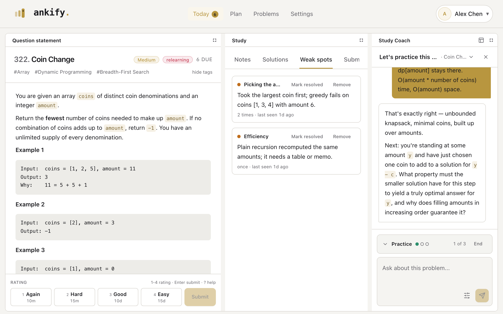
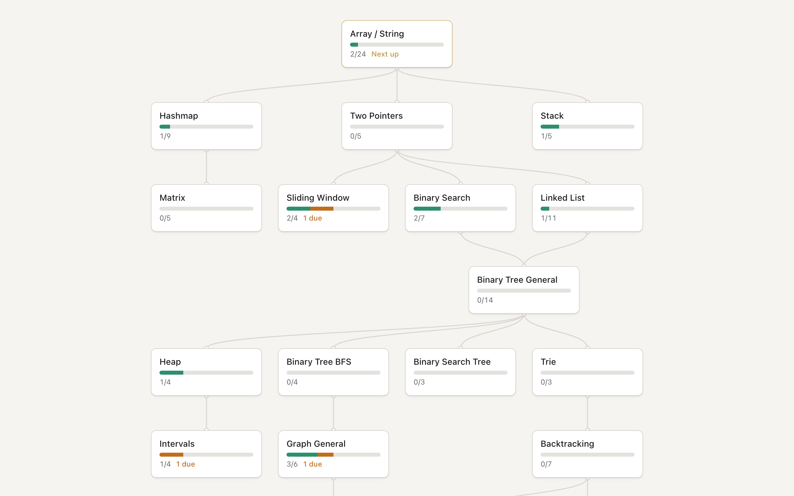
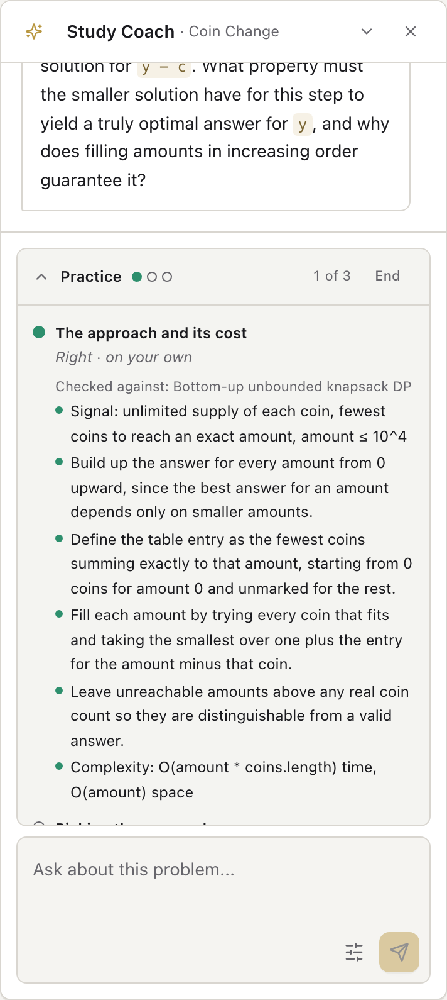
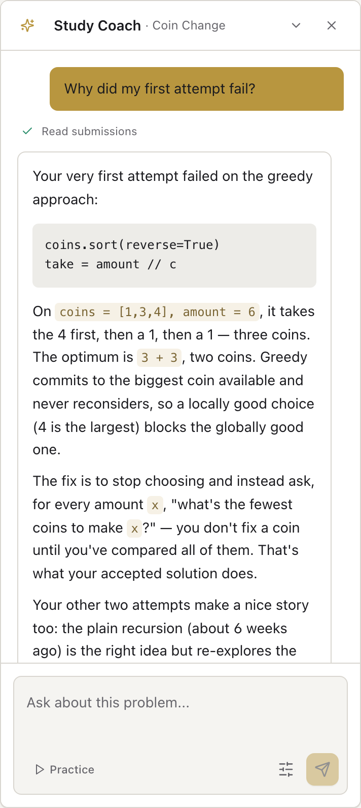
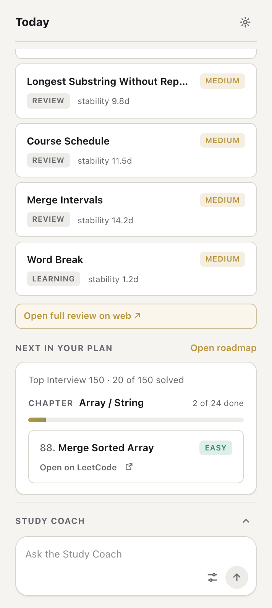
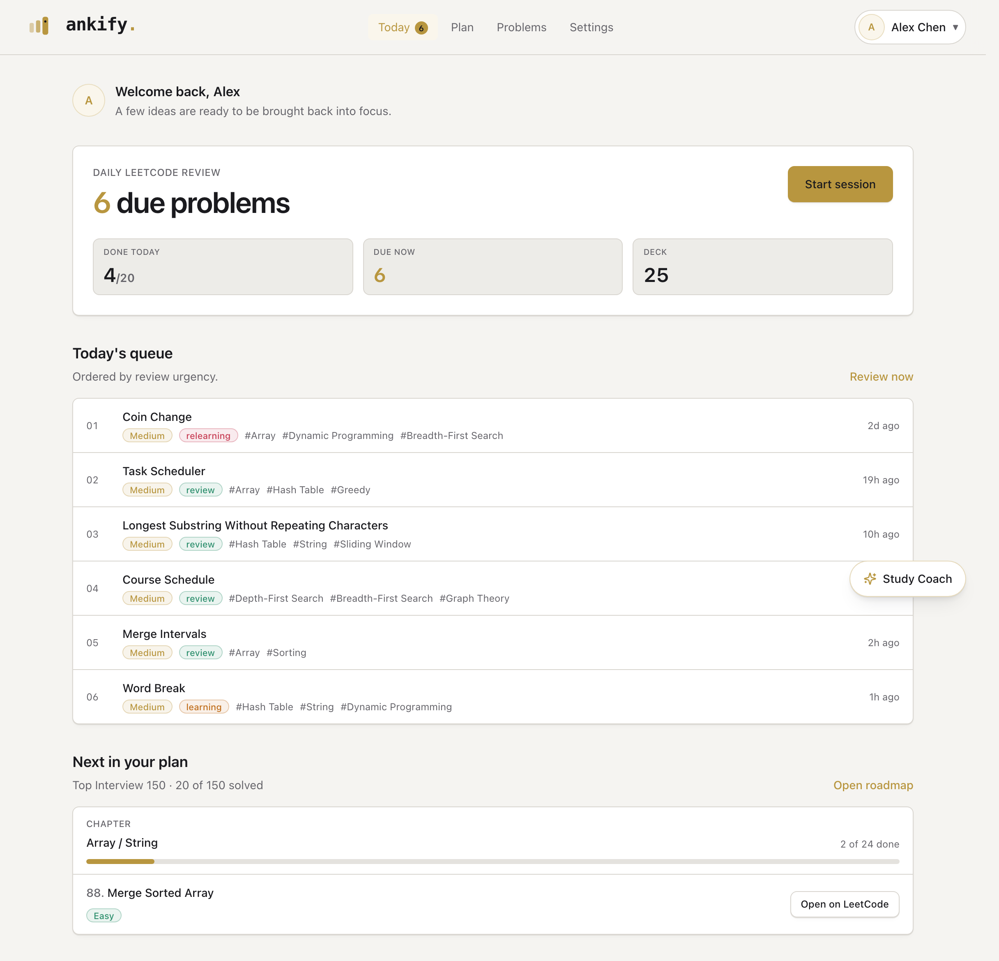

<div align="center">

# ankify

**Follow a plan. Learn the patterns. Keep them.**

Pick a study plan and work through it chapter by chapter on LeetCode.<br>
ankify collects what you solve and brings each problem back before it fades, with a Study Coach that asks which technique it takes and what in the statement tells you.

[**Open the web app**](https://ankify-pi.vercel.app) · [**Add to Chrome**](https://chromewebstore.google.com/detail/ankify/gcldkcaidjnkaagngppblefddapdpaeb) · [Self-host](docs/SELF_HOSTING.md)

<br>

<picture>
  <source media="(prefers-color-scheme: dark)" srcset="images/review-workspace-dark.png">
  
</picture>

</div>

---

## The problem

You solve a hard problem. A week later you remember *that* you solved it, but not *how*. Worse, the next problem with the same trick looks new, because you memorized one answer instead of learning the pattern.

- **LeetCode** records what you solved, not what you still remember, and it doesn't review anything with you.
- **Anki** handles vocabulary well, but a pile of disconnected cards is a poor way to review algorithm problems, and it won't tell you what to solve next.

ankify gives you an order to learn in, and checks that you can still recognize each pattern. When Coin Change is due, you don't flip a card. You say which technique it takes and what in the statement points to it, then how you'd solve it and what it costs.

## How it works

| 1 · Pick a plan | 2 · Solve on LeetCode | 3 · Review |
| --- | --- | --- |
| Top Interview 150, LeetCode 75, Top 100 Liked, [灵茶山艾府's lists](https://leetcode.cn/circle/discuss/RvFUtj/), or a public LeetCode list. Your solved history shows where you already are. | The Chrome extension collects a problem on your first new submission, pass or fail, with your code and the failing test case. | Each problem comes back just before you'd forget it. Talk it through with the Coach on the web or beside LeetCode, then confirm your rating. |

---

## Features

### Follow a plan, chapter by chapter

The Plan page draws your study plan (Top Interview 150, LeetCode 75, Top 100 Liked, the Dynamic Programming, Graph Theory, and Binary Search plans, [灵茶山艾府's problem lists](https://leetcode.cn/circle/discuss/RvFUtj/) used with permission, or a public LeetCode list of your own) as a roadmap by chapter: what you've solved, what's in review, and what's due. Each problem shows its chapter and the techniques it uses.

<picture>
  <source media="(prefers-color-scheme: dark)" srcset="images/plan-roadmap-dark.png">
  
</picture>

What's next is always clear:

- **After a problem:** the next one in the chapter. Today shows it right after your reviews.
- **After a chapter:** go deeper on its technique, or move on. Its problems keep coming back in review, mixed with other chapters, so each one has to be recognized first.
- **After a forgotten review:** one easier problem with the same technique.
- **After the plan:** a focused plan for what you forget most.

### Reviews that start with recognizing the pattern

Practice is a conversation about one problem. You say which technique it calls for and what in the statement points to it, then how you'd solve it and what it costs. After that, it asks about up to two of your weak spots on that problem.

<p align="center">
  <picture>
    <source media="(prefers-color-scheme: dark)" srcset="images/practice-panel-dark.png">
    
  </picture>
</p>

- Each reply is checked against a **Solutions doc** for that problem: one section per approach, each starting with its signal, the features of the statement that point to it. It's written the first time you practice, and you can edit it.
- The Coach follows up only on what you left out. The grade comes from code, not from the chat model, and the more help you needed, the lower it goes.
- A rating is suggested when you finish, but you always decide. If you misclick, **Undo** restores the previous schedule.

### Study Coach: an AI tutor that has read your submissions

Study Coach sits beside any page. It uses tools to look up the problem, your submissions, your notes, your weak spots, and your review queue, so it answers about *your* attempt instead of a generic solution.

<p align="center">
  <picture>
    <source media="(prefers-color-scheme: dark)" srcset="images/coach-panel-dark.png">
    
  </picture>
</p>

A real exchange from the screenshot above, lightly trimmed:

> **You:** Why did my first attempt fail?
>
> **Coach** *(reads your submissions)*: Your very first attempt failed on the greedy approach. On `coins = [1,3,4], amount = 6`, it takes the `4` first, then a `1`, then a `1`: three coins. The optimum is `3 + 3`, two coins. Greedy commits to the biggest coin available and never reconsiders.
>
> The plain recursion is the right idea but re-explores the same `rest` values exponentially, which is why `amount = 100` timed out.
>
> One question: for `dp[x]` you wrote `dp[x] = min(dp[x], dp[x - c] + 1)`. Why is the answer built from `dp[x - c]`, the remaining amount, rather than from `dp[c]`, the coin's own value?

The specific mistakes it finds become **weak spots** you can remove, and practice asks about them next time. Edits to your notes wait for your approval.

### Everything beside LeetCode

The side panel follows the problem in your current tab: the Coach, its weak spots, your notes and solutions, and the rating buttons when it's due. The extension collects a problem on your first new submission and syncs later ones. It reads the code in your editor for the Coach, and you can turn that off. Away from a problem, the panel shows today's reviews and what's next in your plan.

<p align="center">
  <picture>
    <source media="(prefers-color-scheme: dark)" srcset="images/extension-side-panel-dark.png">
    
  </picture>
</p>

### And the rest

- **A daily queue with a limit.** Set how many problems you review per day. Today ranks what's due by urgency, then shows the next problem in your plan.
- **Notes that stay yours.** Each problem keeps your Notes and its Solutions as markdown you can edit.
- **Start on free AI credits, then bring your own model.** New accounts get free credits for the Study Coach. After that, add your own Anthropic, OpenAI, or DeepSeek key. Keys are encrypted with AES-256-GCM before they reach the database, and your own key always takes priority.
- **English or 简体中文.** The interface and AI output each have their own language setting.
- **Your data stays yours.** Export everything as NDJSON or delete your account from Settings.

<picture>
  <source media="(prefers-color-scheme: dark)" srcset="images/today-dark.png">
  
</picture>

---

## Get started

1. **Sign in** at [ankify-pi.vercel.app](https://ankify-pi.vercel.app) with Google and **choose a study plan**.
2. **Install the [Chrome extension](https://chromewebstore.google.com/detail/ankify/gcldkcaidjnkaagngppblefddapdpaeb).** It reuses your web login, so there's no token to paste.
3. **Try the AI features on free credits.** When they run out, add your own Anthropic, OpenAI, or DeepSeek key in Settings.
4. **Submit on the next problem in your plan.** The extension collects it, and it comes up for review the next day. To review one right away, open it and choose *Add now*.

Open **Today** for your reviews and your next problem.

## Built with

| Layer | Stack |
| --- | --- |
| Scheduling | [`ts-fsrs`](https://github.com/open-spaced-repetition/ts-fsrs) FSRS-6. Each problem is scheduled as one item. |
| AI | Vercel AI SDK: a `ToolLoopAgent` for Study Coach, and a separate judge call for each practice reply |
| Web + API | Next.js 16 App Router, TypeScript, Tailwind |
| Extension | Chrome MV3, Vite, React |
| Data | Drizzle ORM on Turso / libSQL (SQLite locally). Every business table is scoped by `userId`. |
| Auth | Better Auth + Google OAuth. The extension shares the web session. |

## Self-hosting and development

Local setup, the QA and demo environments, database profiles, Vercel deployment, and release checks are covered in **[docs/SELF_HOSTING.md](docs/SELF_HOSTING.md)**.

```bash
pnpm install
cp .env.example .env.local
pnpm db:migrate
pnpm dev          # http://localhost:3000
```

Want to look around without setting up Google OAuth? Run `pnpm dev:demo` and open `http://localhost:3000/api/qa/login`. The screenshots in this README come from that demo deck.

## License

[MIT](LICENSE)
